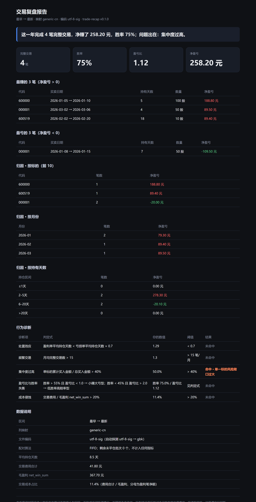

# trade-recap

**把你的券商交割单，变成一份诚实的年度复盘报告——纯本地、零依赖、数据不出机器。**

券商 App 的「年度账单」只告诉你总盈亏，不告诉你**你错在哪**。trade-recap 用 FIFO 把买卖配成完整交易，再算出胜率、盈亏比、盈亏归因和行为诊断。它读本地 CSV，只写 `report.md` / `report.html` 两个文件，不联网。



> 上图是 `python cli.py recap fixtures/synthetic.csv` 生成的 `report.html` 真实截图（含合成数据的全部小节）。纯文本版见 `examples/report.md`。

> 报告里的颜色跟 A 股一个习惯：**红是赚钱，绿是亏钱**。
> 行为诊断里橙色是「这条要改」，灰蓝色是「这条没事」。

## 快速开始

```bash
# 1. 看一眼你的交割单有哪些列（未映射的列会明确提示）
python cli.py columns 交割单.csv

# 2. 看看内置了哪些券商列映射
python cli.py mappings

# 3. 出一份年度报告
python cli.py recap 交割单.csv --mapping generic-cn --year 2026

# 任意区间 + 指定输出路径
python cli.py recap 交割单.csv --mapping huatai --from 2026-01-01 --to 2026-06-30 --out report.md

# 想分享截图又不想暴露金额和代码
python cli.py recap 交割单.csv --mask
```

跑完你会得到：

- 终端摘要 7 行
- `report.md`：完整明细，可贴进任何笔记软件
- `report.html`：单文件内联样式，离线可开，首屏是一句话结论 + 4 个核心数字

内置映射：`generic-cn`（通用 A 股）、`huatai`（华泰）、`eastmoney`（东方财富）。列名不一样？复制一份 `mappings/*.json` 改 `columns` 就行，代码里没有任何硬编码列名。

## 合规红线

**这是事后复盘工具，不是投资建议工具。**

- 报告里没有、也不会有任何买入/卖出/持仓建议，不出现「目标价」「看好」「预期收益」。
- 不接行情、不算技术指标、不预测未来。
- 代码零网络调用：不允许 `socket` / `urllib` / `http` / `requests` / `ftplib` / `ssl`，有测试用 `ast` 静态扫描守着。
- 不修改输入文件，不写临时文件（跑前后 sha256 一致，有测试守着）。

README 与报告页脚固定包含以下免责声明：

> 本工具仅对用户本人的历史交易记录做统计与归因，不构成任何投资建议，不预测未来收益。所有结论仅反映过去已发生的交易事实。投资有风险，决策请自行判断。

## 指标口径

口径写死在代码注释里，也写在这里，避免两处不一致。

| 指标 | 定义 |
|---|---|
| 完整交易数 | FIFO 配对后形成的「买入→卖出」闭环笔数 |
| 胜率 | 盈利的完整交易数 / 完整交易数（按净盈亏判定，已扣两端费用） |
| 盈亏比 | 平均盈利额 / 平均亏损额的绝对值 |
| 平均持仓天数 | 配对后 卖出日 − 买入日 的平均值（自然日，按笔平均） |
| 最赚的三笔 | 仅 `net_pnl > 0` 的完整交易，按净盈亏降序取前 3；不足 3 笔就有几笔列几笔，一笔不赚则写「本期没有盈利交易」 |
| 最亏的三笔 | 仅 `net_pnl < 0` 的完整交易，按净盈亏升序取前 3；同上，一笔不亏则写「本期没有亏损交易」 |
| 归因·按标的 | 每个股票的累计净盈亏、交易次数，取绝对值前 10 |
| 归因·按月份 | 按卖出日归属的每月净盈亏与笔数 |
| 归因·按持有天数 | `≤1天` / `2–5天` / `6–20天` / `>20天` 各桶笔数与净盈亏 |
| 毛盈利（`net_win_sum`） | **只算盈利笔**的**净盈亏**之和（已扣买卖两端费用，不含亏损笔）。名字里的「毛」指「只算赚的那部分」，金额是净额；旧键名 `gross_profit` 保留为同义键 |
| 交易成本占比 | 手续费 + 印花税合计 / 毛盈利（`net_win_sum`）；分母为净额而非毛额，毛盈利 ≤ 0 时显示「不适用」 |

## 行为诊断

只用交割单能证明的东西。每项都同时给出「你的数值」和「判定阈值」，**未命中的项也会列出**——你需要看到「我这项是好的」。

| 诊断项 | 判定式 |
|---|---|
| 处置效应 | 盈利单平均持仓天数 < 亏损单平均持仓天数 × 0.7 → 赚了就跑，亏了死扛 |
| 频繁交易 | 月均完整交易数 > 15 → 命中 |
| 集中度过高 | 单标的累计买入金额 / 总买入金额 > 40% → 命中 |
| 盈亏比与胜率失衡 | 胜率 > 55% 且 盈亏比 < 1.0 → 小赚大亏型；胜率 < 45% 且 盈亏比 > 2.0 → 低胜率高赔率型 |
| 成本侵蚀 | 交易费用 / 毛盈利（`net_win_sum`） > 20% → 命中 |

## `--mask` 做了什么

只改渲染，不改数值。

- 股票代码 → `60****`
- 单笔金额 → 占「最大单笔盈利额」的百分比（仍能比较大小，读不出真实金额）
- 汇总金额 → `Σ`（不可反推）
- 比率类（胜率、盈亏比、成本占比、集中度、平均持仓天数）与笔数 → **一字不变**

## 已知边界

v0.1 只做能算准的事，以下都不处理：

- **不处理分红送股 / 配股 / 复权**：数量或成本因除权而变化的交割单，配对结果会失真，可能直接报「无持仓」错误。
- **不处理融券 / 卖空**：卖出量超过持仓即报错，不做盈亏归因。
- **同一标的跨年配对按 FIFO 全量配对**：不做年度内强制平仓，所以 `--year` 让区间只覆盖部分持仓周期时会报错，请覆盖完整持仓周期。
- **不看行情**：没有价格序列，就不做「买在当日最高点」这类需要行情的判断。
- **不做税务口径区分**：费用按交割单里的费用列合计，不拆分印花税与佣金。

## 目录结构

```
trade-recap/
├── cli.py              # 入口：recap / columns / mappings
├── core/
│   ├── loader.py       # CSV 编码探测 + 列映射
│   ├── pair.py         # FIFO 配对（核心）
│   ├── metrics.py      # 指标
│   ├── diagnosis.py    # 行为诊断
│   ├── masking.py      # --mask 打码
│   └── report.py       # md / html / 终端摘要
├── mappings/           # 券商列映射
├── fixtures/           # 可控的手算样例
├── tests/              # 验收测试
└── examples/           # 由 fixtures 生成的两份示例报告
```

## 跑测试

```bash
python -m unittest discover -s tests -t .
```

零第三方依赖，只用标准库。Python 3.9+。
